# Chapter 02 — Scale From Zero To Millions Of Users

> **Goal of this chapter:** take one server running one app and one database, and walk it — step by step, with a reason for every step — to an architecture that serves millions of daily active users. Every scaling decision below is triggered by a *specific pain*, not by fashion.

---

## 0. How to read this chapter

Scaling is not a checklist you apply upfront. It is a **loop**:

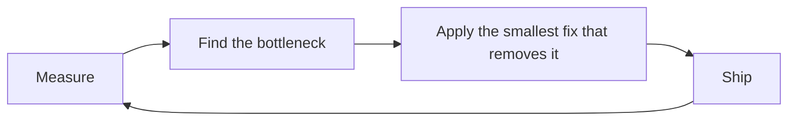

Premature scaling is the most common junior mistake in system design interviews. The senior signal is: *"here is the symptom, therefore here is the fix, and here is the new cost I just accepted."*

Every section below follows that shape:

| Symptom | Fix | New problem it creates |
|---|---|---|

---

## 1. Single server setup

Everything on one box: web app, database, cache, static files.

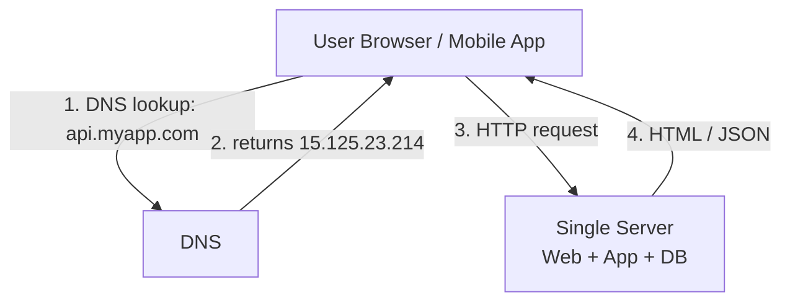

**Request flow**

1. Client asks DNS for `api.myapp.com`. DNS is usually a **third-party paid service**, not on your server.
2. DNS returns an IP address.
3. Client sends HTTP(S) to that IP.
4. Server returns HTML (browser) or JSON (mobile app).

**Traffic sources you must support**
- Web browsers (HTML/JS/CSS)
- Mobile apps (HTTP + JSON over a REST-ish API)

This is fine for a prototype, a demo, or your first 100 users. It fails the moment you need *availability* (one crash = total outage) or *capacity* (CPU and DB fight for the same RAM).

---

## 2. Split out the database

**Symptom:** the app and the DB compete for CPU/RAM on the same machine. You cannot scale them independently — the web tier wants more CPU, the DB wants more disk and RAM.

**Fix:** move the database to its own server.

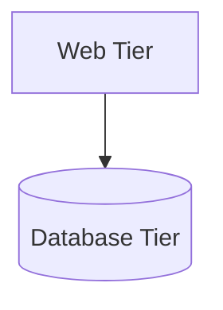

Now each tier can be scaled and tuned separately.

### Which database? Relational vs Non-relational

**Relational (RDBMS): MySQL, PostgreSQL, Oracle.**
Data lives in tables and rows; you can `JOIN` across tables. 40+ years of tooling. Strong ACID transactions.

**Non-relational (NoSQL):** four broad families —
- **Key-value:** Redis, DynamoDB
- **Column:** Cassandra, HBase
- **Document:** MongoDB, Couchbase
- **Graph:** Neo4j

**Default to relational.** Pick NoSQL only when at least one is true:
- Your app needs **super-low latency** at massive scale.
- Data is **unstructured** or has no relational shape.
- You only need to **serialize/deserialize** objects (JSON/YAML blobs).
- You must store a **truly massive** amount of data (petabytes).

> ⚠️ Interview trap: saying "I'll use NoSQL because it scales" with no justification. NoSQL scales *because it drops joins and multi-row transactions*. Name the trade you're making.

---

## 3. Vertical vs Horizontal scaling

| | Vertical ("scale up") | Horizontal ("scale out") |
|---|---|---|
| What | Add CPU/RAM to one box | Add more boxes |
| Pros | Dead simple, no code change | Elastic, no hard cap |
| Cons | **Hard ceiling** (you cannot add infinite CPU); **no failover, no redundancy** — one box down = site down | Needs a load balancer, statelessness, distributed thinking |
| Use when | Low traffic | Large scale (the real answer) |

Because of the failover and ceiling problems, **large systems are horizontally scaled.** But horizontal scaling immediately requires a load balancer.

---

## 4. Load balancer

**Symptom:** if users hit the web server directly and it goes down, the site is down. If too many users hit it, it slows or refuses connections.

**Fix:** put a **load balancer** in front of a pool of web servers.

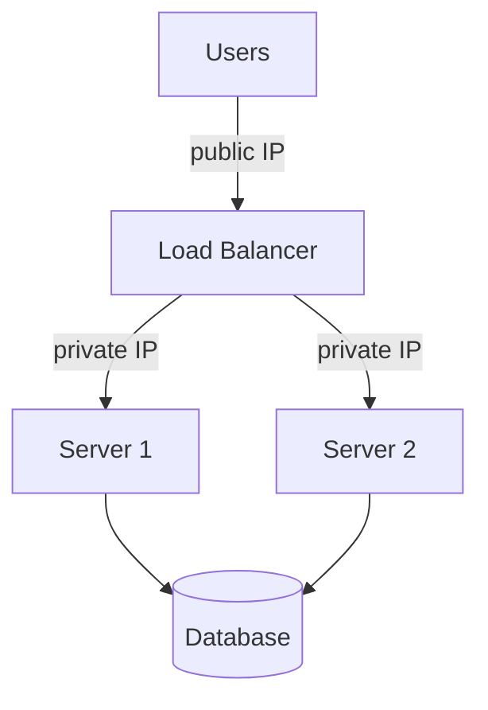

Key points:
- **Users only know the load balancer's public IP.** Web servers get **private IPs**, unreachable from the internet — this is a big security win.
- LB↔server communication happens over the **private network**.
- **Failover:** if Server 1 dies, the LB routes all traffic to Server 2. It also stops new requests from being sent to the dead node (via health checks).
- **Capacity:** traffic grows → add Server 3, 4, 5 to the pool. The LB spreads the load automatically.

The web tier is now solved. **The database is now the single point of failure.**

---

## 5. Database replication

**Symptom:** one DB. If it dies, everything dies. Reads (typically 10–100× more common than writes) overwhelm it.

**Fix:** **master–slave replication** (also called primary–replica / leader–follower).

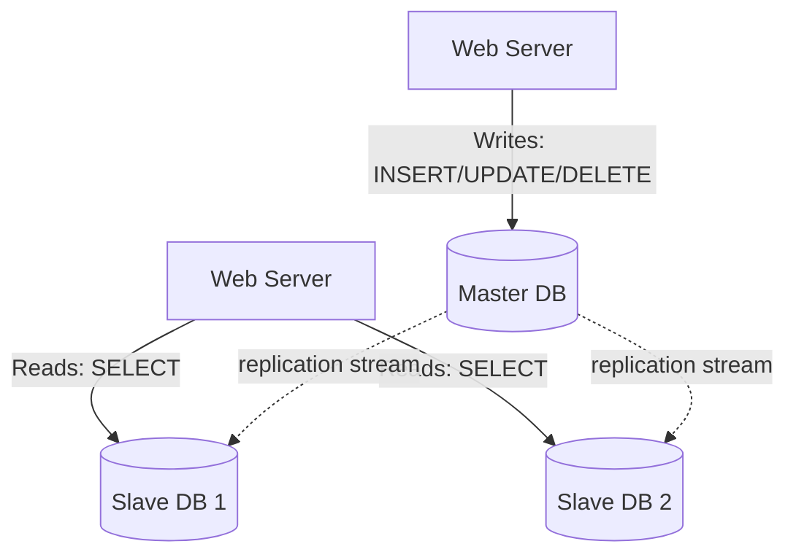

- **Master** takes only **writes**.
- **Slaves** take only **reads**, and copy data from the master.
- Most apps have a much higher read:write ratio, so you add many slaves and few masters.

**Advantages**
- **Better performance** — reads spread across replicas, parallel query processing.
- **Reliability** — data survives the loss of one node (natural disaster, disk failure).
- **High availability** — the site stays readable even if one DB is offline.

**Failure handling**

| Scenario | What happens |
|---|---|
| One slave dies (multiple slaves exist) | Reads redirect to healthy slaves; replace the node |
| Only slave dies | Reads temporarily go to the master; spin up a replacement |
| **Master dies** | A slave is **promoted** to the new master; a new slave is provisioned. |

> ⚠️ Master promotion is genuinely hard. The promoted slave may be **behind** on replication, so some writes are lost. You need recovery scripts to replay missing data, and more advanced schemes (multi-master, circular replication) exist. Mentioning this nuance is a strong senior signal.

Full picture so far:

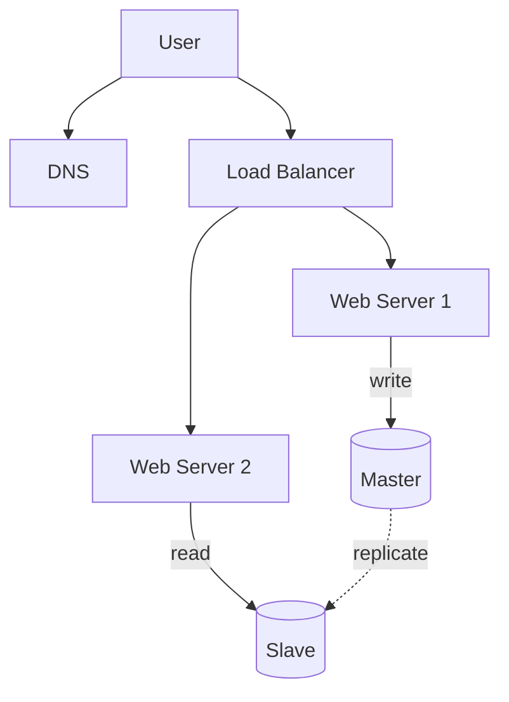

**Request flow:** user gets the LB IP from DNS → connects to LB → LB routes to a web server → web server reads from a slave and writes to the master.

---

## 6. Cache

**Symptom:** page loads are slow. Every request hits the DB, even for data that hasn't changed and is requested constantly.

**Fix:** a **cache** — a fast in-memory store of expensive-to-compute or frequently-accessed results.

### Cache tier

A separate layer, scaled independently of the DB.

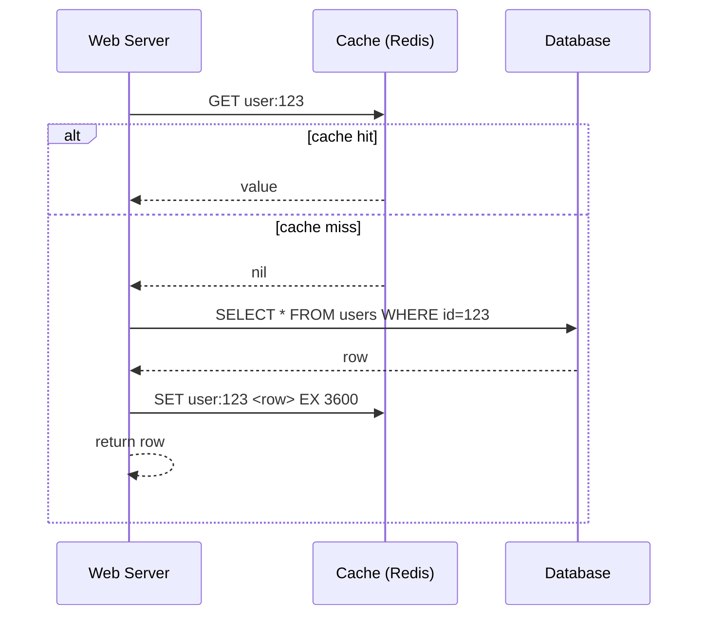

This is the **read-through / cache-aside** pattern.

### Considerations for using cache

1. **When to use:** data read **frequently**, modified **infrequently**.
2. **Not a datastore:** cache is in memory — it is volatile. **Persist important data in the DB.**
3. **Expiration policy (TTL):** too short → too many DB hits. Too long → stale data. Not too short, not too long.
4. **Consistency:** keeping cache and store in sync is hard, especially across regions. Scaling across multiple regions makes this worse.
5. **Single point of failure:** a single cache node is an SPOF. Over-provision memory and use **multiple cache servers across different data centres**.
6. **Eviction policy:** when memory is full, evict. **LRU** is the default choice; LFU and FIFO are alternatives.

> **Cache stampede / thundering herd** — when a hot key expires, thousands of requests miss simultaneously and slam the DB. Fixes: request coalescing (single-flight), probabilistic early expiry, or a lock on the recompute.

---

## 7. Content Delivery Network (CDN)

**Symptom:** users in Sydney wait 300ms for a logo served from Virginia. Static assets eat your web servers' bandwidth.

**Fix:** a **CDN** — a geographically distributed network of proxy servers caching **static content** (images, video, CSS, JS).

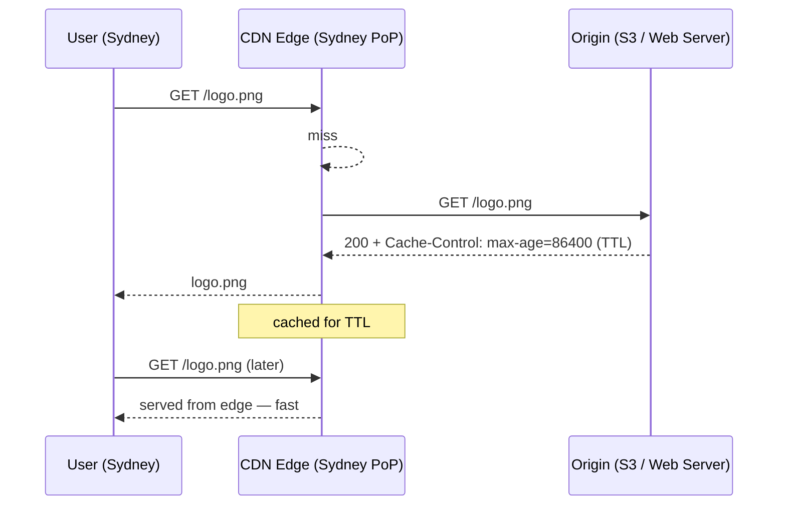

The **first** user pays the origin round-trip. Everyone else in that region is served from the edge until the TTL expires.

### CDN considerations

1. **Cost.** CDNs are billed on data transfer in/out. Don't cache infrequently-used assets — they cost money and provide no benefit.
2. **Cache expiry (TTL).** Too long = stale content; too short = you keep re-fetching from origin.
3. **CDN fallback.** Clients must detect a CDN outage and request from origin.
4. **Invalidating files.** Two ways: (a) call the CDN vendor's **invalidation API**; (b) **object versioning** — serve `image.png?v=2`, which changes the URL and therefore the cache key. Versioning is the safer, more common approach.

Architecture now:

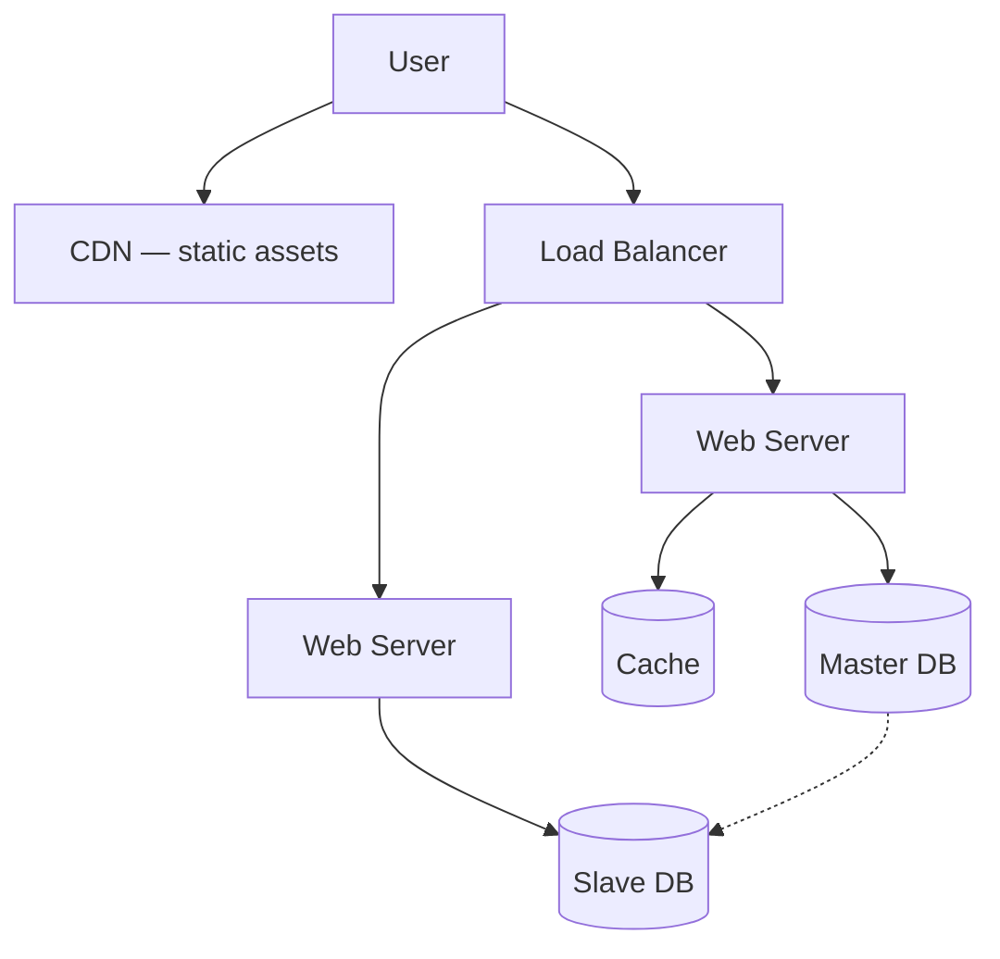

- Static assets (JS/CSS/images/video) are **no longer served by web servers** — the CDN handles them.
- DB load is reduced by the cache.

---

## 8. Stateless web tier

**Symptom:** you kept session data on the web server ("sticky sessions"). Now the LB must always route User A back to Server 1. Adding/removing servers becomes painful, and if Server 1 dies, User A is logged out.

```mermaid
flowchart LR
    subgraph Stateful — BAD
      A[User A] --> SA[Server 1<br/>session A stored here]
      B[User B] --> SB[Server 2<br/>session B stored here]
    end
```

**Fix:** move state **out** of the web tier into a shared persistent store (Redis, Memcached, or a NoSQL store like DynamoDB).

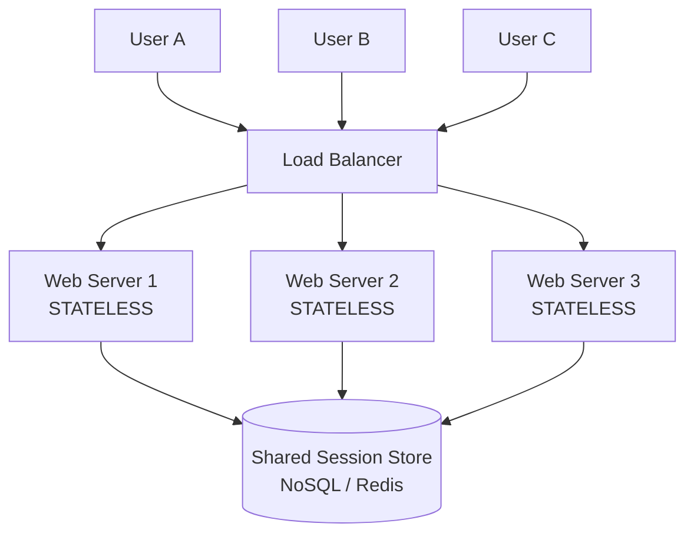

Now **any** web server can handle **any** request. You can autoscale the web tier freely: add servers when traffic rises, remove them when it falls.

> **This is the single most important structural move in the chapter.** Statelessness is what makes horizontal scaling actually work.

---

## 9. Data centers (multi-region)

**Symptom:** all your servers are in `us-east`. Users in Asia are slow, and one regional outage takes you offline entirely.

**Fix:** multiple data centres with **geoDNS** routing users to the nearest one.

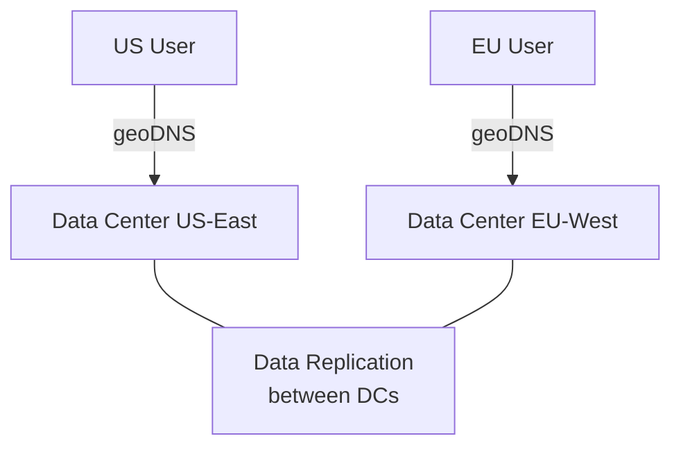

In a normal state, traffic is **geo-routed** (say 50/50). During a DC outage, **100% of traffic fails over** to the healthy DC.

### Technical challenges

1. **Traffic redirection** — geoDNS resolves a domain to different IPs per user location.
2. **Data synchronization** — users in different regions may use different local DBs. On failover, users hit a DC with **no data**. The standard solution is to **replicate data across data centers** (e.g. Netflix's multi-DC async replication).
3. **Test and deployment** — you must test from different geographies, and automated deployment must keep all DCs consistent.

---

## 10. Message queue — decoupling

**Symptom:** a user uploads a photo. The web server must resize it into 5 formats, watermark it, and re-encode video. The user's HTTP request hangs for 30 seconds. If the resizer is slow, the whole site is slow.

**Fix:** a **message queue** — a durable buffer supporting async communication.

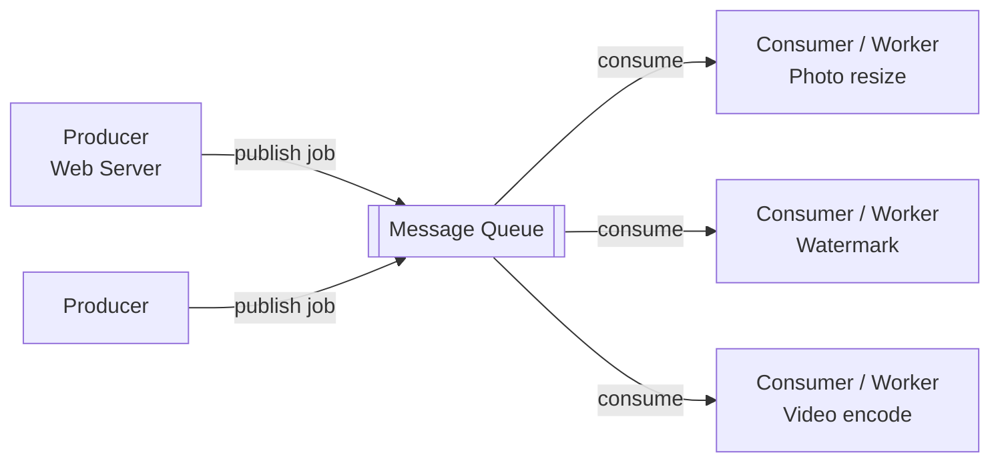

- **Producer** publishes a message and returns immediately — the user gets a fast `202 Accepted`.
- **Consumers/workers** pick up jobs and process them asynchronously.
- **Decoupling:** the producer can publish even when consumers are all down. Consumers can process even when the producer is down.
- **Independent scaling:** queue backlog growing? Add workers. Queue empty? Remove workers to save money.

This is the foundation of every async pipeline: notifications, email, analytics, ML inference, video transcoding.

---

## 11. Logging, metrics, automation

Non-negotiable once the system is non-trivial.

- **Logging** — errors must be aggregated centrally (per-server log files don't scale). Tools: ELK, Splunk, Loki.
- **Metrics** — collect and understand health.
  - *Host-level:* CPU, memory, disk I/O
  - *Aggregated:* whole DB tier, whole cache tier
  - *Key business metrics:* DAU, retention, revenue — these are what actually matter
- **Automation** — CI to catch problems early; automated build/test/deploy to ship reliably.

---

## 12. Database scaling — the final boss

Vertical DB scaling (a bigger box, e.g. 24 TB RAM) hits the same ceiling and cost curve as before, plus SPOF risk.

**Fix: sharding.** Split a large DB into smaller, identical-schema pieces called **shards**. Each shard holds a **unique slice** of the data.

```mermaid
flowchart TD
    App[Application] -->|hash(user_id) % 4 = 0| S0[(Shard 0)]
    App -->|= 1| S1[(Shard 1)]
    App -->|= 2| S2[(Shard 2)]
    App -->|= 3| S3[(Shard 3)]
```

Example: `user_id % 4` → routes each user to one of four shards.

### Choosing a sharding key (partition key)

The **sharding key** determines how data is distributed. Pick one that **evenly distributes** data. This is the most consequential decision in the whole design — get it wrong and you cannot fix it cheaply.

### Problems sharding introduces

| Problem | Explanation | Mitigation |
|---|---|---|
| **Resharding** | A shard fills up, or uneven distribution causes **shard exhaustion**. You must move data. | **Consistent hashing** (see Ch. 06) |
| **Celebrity / hotspot problem** | Justin Bieber and Lady Gaga land on the same shard → that shard is overwhelmed by reads. | Give each celebrity their **own shard**, or further partition |
| **Join & de-normalization** | You cannot `JOIN` across shards. | **De-normalize** data so queries hit a single shard |

Final architecture:

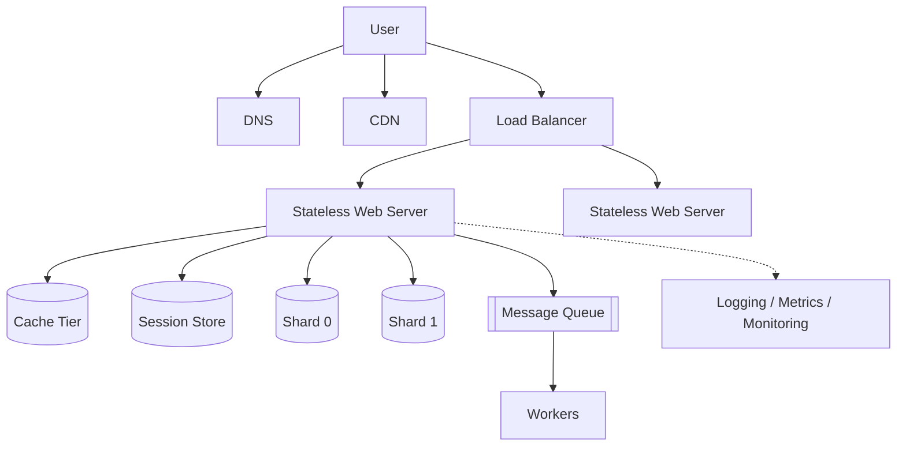

Non-relational stores are often moved to NoSQL at this point to reduce the DB load further.

---

## 13. The scaling playbook — summary

To scale to millions of users:

1. **Keep the web tier stateless**
2. **Build redundancy at every tier**
3. **Cache data as much as you can**
4. **Support multiple data centers**
5. **Host static assets in a CDN**
6. **Scale your data tier by sharding**
7. **Split tiers into individual services** (→ microservices)
8. **Monitor your system and use automation tools**

---

## 14. Senior-level notes (beyond the basics)

- **Every layer you add is a layer that can fail.** A cache adds a consistency bug class. A queue adds duplicate-delivery and ordering bugs. A CDN adds staleness. Seniors name the cost.
- **Read:write ratio drives the design.** 100:1 → replicas + cache. 1:1 → sharding and write-path optimization. Ask for it.
- **Availability math:** components in *series* multiply. Three 99.9% services in a chain = 99.7%. Redundancy in *parallel* is what raises availability.
- **Sharding is a last resort.** Try: read replicas → cache → better indexes → archiving cold data → NoSQL for the biggest table → *then* shard. Sharding permanently costs you joins and transactions.

---

## 15. Interview Questions

**Warm-up**
1. Why is a single-server architecture unacceptable for a production system with paying customers? Give two independent reasons.
2. When would you choose vertical scaling over horizontal scaling?
3. What is the read:write ratio of a typical social app, and how does it change your architecture?

**Core**
4. Walk me through what happens when the **master database dies** in a master-slave setup. What data could be lost, and why?
5. Your cache has a hot key that expires. 50,000 requests miss simultaneously and take down the DB. What is this called and how do you fix it?
6. Why does a **stateless** web tier matter? What breaks if sessions are stored on the web server?
7. You have to invalidate a CDN-cached image immediately. Give two approaches and say which you'd pick.
8. What is the "celebrity problem" in sharding, and how do you solve it?

**Deep / senior**
9. You've sharded on `user_id`. Product now wants "show me all orders in the last 24 hours across all users." What breaks, and what do you do about it?
10. Design the failover flow for a two-region active-active deployment. What happens to in-flight writes when Region A dies?
11. Adding a message queue introduces at-least-once delivery. Your worker charges a credit card. How do you prevent double charges?
12. Your p50 latency is 40ms but p99 is 2s. What are the likely causes, and why does averaging hide the problem?
13. Justify a NoSQL store over Postgres for a specific table in your system — and state exactly what you are giving up.

**Discussion**
14. What would you *not* build on day one, even though you know you'll need it at 10M users? Defend the trade-off.
