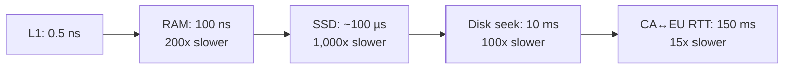
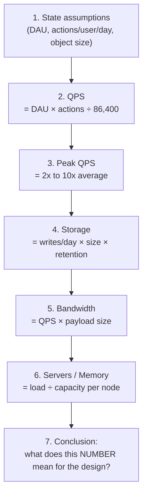

# Chapter 03 — Back-of-the-Envelope Estimation

> **Goal:** learn to produce, in under 5 minutes and with no calculator, a defensible estimate of QPS, storage, bandwidth, and server count — and know *why* interviewers ask.

---

## 0. Why interviewers ask this

They are **not** testing arithmetic. They are testing whether you can:

1. **Reason about scale** — is this a 10 QPS problem or a 1,000,000 QPS problem? The answer changes the entire architecture.
2. **State assumptions out loud** — the number is worthless; the *reasoning chain* is the product.
3. **Round aggressively** — a senior engineer says "call it 1 billion, that's close enough." A junior tries to compute 8,647,209,113.
4. **Know when to stop** — you estimate to *choose an architecture*, not to file a capacity-planning report.

> Jeff Dean: *"Back-of-the-envelope calculations are estimates you create using a combination of thought experiments and common performance numbers to get a good feel for which designs will meet your requirements."*

---

## 1. The building blocks you must memorize

### Power of two

Data volume in bytes. **Memorize this table.** It is the single highest-ROI thing in this chapter.

| Power | Approx value | Name | Short |
|---|---|---|---|
| 2^10 | 1 thousand | 1 Kilobyte | 1 KB |
| 2^20 | 1 million | 1 Megabyte | 1 MB |
| 2^30 | 1 billion | 1 Gigabyte | 1 GB |
| 2^40 | 1 trillion | 1 Terabyte | 1 TB |
| 2^50 | 1 quadrillion | 1 Petabyte | 1 PB |

**Practical rule:** treat 1 KB ≈ 1,000 bytes, 1 MB ≈ 10^6, 1 GB ≈ 10^9, 1 TB ≈ 10^12, 1 PB ≈ 10^15. The ~2.4% error is irrelevant at estimation scale.

---

### Latency numbers every programmer should know

(Jeff Dean's numbers, updated for modern hardware. Learn the **orders of magnitude**, not the digits.)

| Operation | Time |
|---|---|
| L1 cache reference | 0.5 ns |
| Branch mispredict | 5 ns |
| L2 cache reference | 7 ns |
| Mutex lock/unlock | 100 ns |
| **Main memory reference** | **100 ns** |
| Compress 1 KB with Zippy | 10 μs (10,000 ns) |
| **Send 2 KB over 1 Gbps network** | **20 μs** |
| **Read 1 MB sequentially from memory** | **250 μs** |
| Round trip within same datacenter | 500 μs |
| **Disk seek (spinning)** | **10 ms** |
| **Read 1 MB sequentially from network** | **10 ms** |
| **Read 1 MB sequentially from disk** | **30 ms** |
| **Send packet CA → Netherlands → CA** | **150 ms** |

**Conclusions you should be able to state from this table:**

- **Memory is fast; disk is slow.** ~1000× difference. This is the entire justification for caching.
- **Avoid disk seeks if possible.** Sequential reads are far cheaper than random seeks.
- **Simple compression is fast.** Compress before sending over the network — it's basically free.
- **Data centre transfer takes time.** Cross-continent round trips are ~150 ms — you cannot make a chatty protocol feel fast across an ocean.



Each step is roughly **2–3 orders of magnitude**. That's the mental model.

---

### Availability numbers ("the nines")

**High availability** = the system stays operational for a desirably long period. Measured as a percentage; 100% means zero downtime. Most services are between 99% and 100%.

An **SLA** (Service Level Agreement) is the formal uptime commitment. AWS, Google, and Azure all set SLAs at 99.9% or above.

| Availability | Downtime/day | Downtime/year |
|---|---|---|
| 99% ("two nines") | 14.40 min | 3.65 days |
| 99.9% ("three nines") | 1.44 min | 8.77 hours |
| 99.99% ("four nines") | 8.64 s | 52.60 minutes |
| 99.999% ("five nines") | 864 ms | 5.26 minutes |
| 99.9999% ("six nines") | 86.4 ms | 31.56 seconds |

> **Senior insight:** each additional nine is roughly **10× the engineering cost**. Also: availability of services in *series* **multiplies**. Three 99.9% dependencies chained = 99.7% (≈ 26 hours/year down). Redundancy in *parallel* is what buys you nines.

---

## 2. The estimation recipe

Always follow this order. It is the same every time.



### Step 0 — Round everything

- 1 day = 86,400 s → **call it 100,000 s (10^5)**. Error: ~16%. Who cares.
- 1 month = 30 days. 1 year = 365 days ≈ **400 days** if it makes the math nicer.
- 1 million = 10^6. 1 billion = 10^9.

### Step 1 — Anchor on DAU

Everything flows from Daily Active Users. If the interviewer doesn't give it, **propose one and get agreement**: "Let's say 100 million DAU — sound right?"

### Step 2 — QPS

```
QPS = (DAU × actions per user per day) / 86,400 s
```

### Step 3 — Peak QPS

Traffic is not flat. It follows a diurnal curve.

```
Peak QPS = Average QPS × 2   (conservative)
         = Average QPS × 5–10 (spiky consumer apps, live events)
```

**You design for peak, not average.** State the multiplier you chose and why.

### Step 4 — Storage

```
Storage per day  = writes/day × average object size
Storage in 5 yrs = storage/day × 365 × 5
```
Then add **replication factor** (×3 is standard) and **metadata/index overhead**.

### Step 5 — Bandwidth

```
Bandwidth = QPS × average payload size (bytes/sec)
```
Compute ingress (writes) and egress (reads) separately — they're wildly different for read-heavy systems.

### Step 6 — Memory (cache sizing)

Use the **80/20 rule**: 20% of the data serves 80% of the requests. Cache the hot 20%.

```
Cache size = daily read volume × 20% × object size
```

---

## 3. Worked example — Estimate Twitter QPS and storage

**Assumptions (stated out loud):**
- 300 million MAU
- 50% of users use Twitter daily → **150 M DAU**
- Users post **2 tweets per day** on average
- **10%** of tweets contain media
- Data is stored for **5 years**

### QPS

```
Tweets per day = 150 M × 2 = 300 M
Average QPS    = 300,000,000 / 86,400  ≈  3,472  →  ~3,500 QPS
Peak QPS       = 2 × Average           ≈  7,000 QPS
```

### Storage

Estimate the average tweet size:

| Field | Size |
|---|---|
| `tweet_id` | 64 bytes |
| `text` | 140 bytes |
| `media` | 1 MB (only 10% of tweets) |

```
Media storage/day = 150 M DAU × 2 tweets × 10% × 1 MB
                  = 30 M × 1 MB
                  = 30 TB / day

Storage for 5 years = 30 TB × 365 × 5
                    ≈ 55 PB
```

(Text is 300M × ~200 B ≈ 60 GB/day — **negligible** next to media. Noticing that and saying "text is a rounding error, media dominates" is exactly the senior move.)

### The conclusion — the part that actually matters

- **~7,000 peak QPS** → this is *not* huge. A few dozen well-tuned app servers handle it. Writes are not the hard part.
- **55 PB of media** → this **is** huge. Media *must* go to blob storage (S3-like) + CDN, never a relational DB.
- **Read QPS is the real problem.** Timeline reads are 100× tweet writes → **fanout, caching, and read replicas dominate the design.**

> Notice: the estimate **directed the architecture**. That's the whole point.

---

## 4. Second worked example — a photo-sharing app

**Assumptions:**
- 10 M DAU
- Each user views 20 photos/day, uploads 0.1 photos/day
- Average photo = 300 KB (post-compression), plus 3 thumbnail sizes = ~400 KB total
- Retain forever, replication factor 3

**Reads**
```
Read QPS = 10M × 20 / 100,000 s  = 2,000 QPS  (avg)
Peak     = 2,000 × 5             = 10,000 QPS
Egress BW = 10,000 × 300 KB      = 3 GB/s  = 24 Gbps   ← CDN is mandatory
```

**Writes**
```
Uploads/day = 10M × 0.1 = 1 M photos/day
Write QPS   = 1M / 100,000 = 10 QPS   (avg), peak ~50 QPS
Storage/day = 1M × 400 KB = 400 GB/day
Per year    = 400 GB × 365 ≈ 146 TB
With 3x replication ≈ 440 TB/year
```

**Cache sizing (80/20)**
```
Daily read bytes = 10M × 20 × 300 KB = 60 TB/day
Hot 20%          = 12 TB
```
12 TB of cache. At ~100 GB RAM per cache node → **~120 cache nodes**. That number alone tells you a single Redis box is a fantasy.

**Read:write ratio = 2,000 : 10 = 200 : 1.** → Read-optimized system. Replicas, cache, CDN. Writes can be async.

---

## 5. Handy reference numbers

| Thing | Rough capacity |
|---|---|
| Modern app server (simple JSON API) | 1,000–10,000 QPS |
| MySQL/Postgres (single node, mixed load) | ~1,000 writes/s, ~10,000 reads/s |
| Redis (single node) | ~100,000 ops/s |
| Cache node RAM | 64–256 GB |
| Commodity SSD | ~500 MB/s, ~50k IOPS |
| 1 Gbps NIC | ~125 MB/s |
| Kafka partition | ~10 MB/s sustained |

**Sizes**
| Type | Size |
|---|---|
| char (ASCII) | 1 byte |
| UUID | 16 bytes (128 bits) |
| Timestamp (epoch ms) | 8 bytes |
| A short URL row | ~100 bytes |
| A tweet (text only) | ~200 bytes |
| A compressed photo | 200 KB – 1 MB |
| 1 min of 1080p video | ~50 MB |

---

## 6. Tips

1. **Rounding and approximation.** It's a hard problem to solve complicated math in an interview. Precision is not expected. Use round numbers.
2. **Write down your assumptions.** Reference them later. Say them *out loud*.
3. **Label your units.** When you write `5`, is it 5 KB or 5 MB? This is where people lose points.
4. **Commonly asked estimations:** QPS, peak QPS, storage, cache, number of servers.
5. **Practice.** These are muscle memory. Do them on a whiteboard until they're automatic.

### Anti-patterns

| ❌ Don't | ✅ Do |
|---|---|
| Silently compute for 3 minutes | Narrate every step |
| Reach for exact `86,400` | Say "~100k seconds, close enough" |
| Estimate and move on | End with *"…therefore the bottleneck is X"* |
| Guess DAU without asking | "I'll assume 100M DAU — OK?" |
| Ignore peak traffic | Always apply a peak multiplier |
| Forget replication | Multiply storage by 3 |

---

## 7. Senior-level notes

- **The purpose of the estimate is to eliminate architectures.** If read QPS is 10, you don't need a cache. If it's 10 million, you need a CDN, multi-layer cache, and probably geo-distribution. Say which architectures your number rules *out*.
- **Estimate the thing that dominates.** Find the term that's 100× the others and ignore the rest. In Twitter, media dwarfs text. In a chat app, metadata dwarfs message content.
- **Bandwidth kills before storage does.** Storage is cheap ($/TB is falling). Egress bandwidth is expensive and is the line item that surprises people. Always compute egress.
- **Tail latency > average latency.** Estimating average response time tells you almost nothing about user experience. p99 is what users feel.
- **Hardware moves; ratios don't.** The absolute numbers above will be wrong in five years. The *ratios* (RAM ≈ 1000× faster than disk) will not.

---

## 8. Interview Questions

**Warm-up**
1. Without a calculator: how many seconds in a day? What do you round it to and why?
2. How much slower is a disk seek than a main-memory reference? By roughly how many orders of magnitude?
3. What does 99.99% availability mean in minutes of downtime per year?

**Core**
4. Estimate the QPS and 5-year storage for a URL shortener with 100 M new URLs/month and a 10:1 read:write ratio.
5. Estimate the daily storage for a system ingesting 1 M IoT sensor readings per second, each 100 bytes. Now add 3× replication and 1 year of retention.
6. You have three microservices in a call chain, each 99.9% available. What's the end-to-end availability? How do you improve it?
7. Estimate how much RAM you need to cache the hot working set of a news feed for 200 M DAU.

**Deep / senior**
8. Your estimate says peak write QPS is 500. Your interviewer says "assume it's 500,000 instead." Which parts of your design change, and which don't?
9. Why do we design for peak QPS and not average? What's the cost of over-provisioning, and what's the alternative? (Hint: autoscaling, queueing, load shedding.)
10. You computed 24 Gbps of egress bandwidth. What does that imply must be in your architecture, and what does it imply about cost?
11. Given the latency table, explain why a synchronous cross-region database write is almost always the wrong design.
12. Your estimate is off by 10×. Does it matter? When does it, and when doesn't it?

**Discussion**
13. An interviewer gives you no numbers at all and says "design Instagram." How do you bootstrap your estimation? What do you ask?
