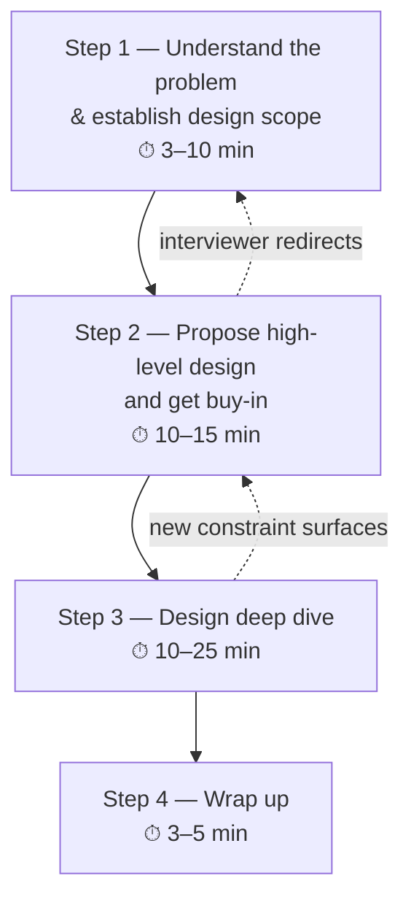

# Chapter 04 — A Framework For System Design Interviews

> **Goal:** a repeatable 4-step process you can run on *any* system design question, plus a clear model of what is actually being evaluated.

---

## 0. What a system design interview really is

It is **not** a quiz with a right answer. There is **no single correct design**.

It is a **simulated collaborative design session** on an open-ended problem. The company wants to know:

- Can you work through **ambiguity** without freezing?
- Can you **communicate** a design so others can build it?
- Can you **evaluate trade-offs** rather than reciting buzzwords?
- Can you take **feedback** and adapt?
- Do you have **red flags** — over-engineering, narrow-mindedness, stubbornness?

> The process of design is what's being graded, not the artifact.

### What it measures

| Signal | What it looks like |
|---|---|
| **Design skills** | Sensible components, clean interfaces |
| **Collaboration** | You ask, you listen, you adapt |
| **Working under pressure** | You stay structured when challenged |
| **Resolving ambiguity constructively** | You *ask questions* instead of assuming |
| **Asking good questions** | Your first move is clarification, not a diagram |

### Red flags 🚩

- **Over-engineering** — proposing Kafka + Kubernetes + service mesh for 100 QPS. Over-engineering carries a real cost that many engineers ignore.
- **Narrow-mindedness** — refusing to consider alternatives.
- **Stubbornness** — dismissing the interviewer's hint.
- **Being obsessed with purity of design** — insisting on the "correct" architecture while ignoring the trade-offs.
- **Jumping straight into a diagram** without understanding the requirements.

---

## 1. The 4-step framework



Total: a **45-minute** interview. Time discipline matters — running out of time before the deep dive is the most common way to fail.

---

## Step 1 — Understand the problem and establish design scope (3–10 min)

### The most important rule

> **Do not jump to a solution.** Slow down. Think deeply. Ask questions.

There is no such thing as a fast, brilliant answer here. Answering without understanding the requirements is a **huge red flag** — the interview is not a trivia contest.

When you ask a question, the interviewer either answers directly or asks you to make an assumption. **If you make an assumption, write it down.** You'll need it later.

### The questions to ask

Group them. Don't machine-gun.

**Functional scope**
- What **specific features** are we building?
- Who are the **users**? (consumers, internal, machines?)
- What's **out of scope**? (This is as important as what's in.)

**Scale**
- How many users? (DAU / MAU)
- How fast is the company expected to **scale up** — what will the numbers look like in 3 months, 6 months, a year?
- What is the **read:write ratio**?

**Constraints & non-functional requirements**
- What's the expected **latency** (p99)?
- What **availability** do we need? Can we tolerate downtime?
- Consistency requirements — strong or eventual?
- Any **regulatory / privacy** constraints (GDPR, PCI)?

**Existing stack**
- What is the company's current **technology stack**? What existing services can I leverage to simplify the design?

### Example — "Design a news feed system"

Good clarifying questions:
- Is this a **mobile app**? A web app? Both?
- What are the **most important features**? Posting and seeing friends' posts?
- Is the feed sorted **reverse chronologically**, or by some **ranking/relevance** score? (This one question changes the entire design.)
- How many **friends** can a user have?
- What's the **traffic volume** (DAU)?
- Can the feed contain **images and videos**, or is it text only?

Note how each answer *eliminates* a chunk of the design space.

### Output of Step 1

Write on the board:

```
FUNCTIONAL REQUIREMENTS
  1. Users can post
  2. Users can see friends' posts in a feed
  3. Feed is reverse-chronological
  (OUT OF SCOPE: ads, ranking, stories, DMs)

NON-FUNCTIONAL REQUIREMENTS
  - 10M DAU
  - Feed loads in < 200ms (p99)
  - Highly available; eventual consistency is acceptable
  - Read-heavy: ~100:1

BACK-OF-ENVELOPE
  - ~1,000 write QPS, ~100,000 read QPS peak
  - ...
```

Get the interviewer to **agree** before moving on.

---

## Step 2 — Propose high-level design and get buy-in (10–15 min)

Goal: a **blueprint** you and the interviewer both accept. This is a **collaboration**, not a presentation.

### How to do it

1. **Come up with an initial design.** Draw **box diagrams** with key components: clients (web/mobile), APIs, web servers, data stores, cache, CDN, message queue.
2. **Ask for feedback constantly.** "Does this look reasonable so far?" Treat the interviewer as a teammate.
3. **Communicate.** Explain your thought process out loud. Silence is a failed signal.
4. **Do back-of-the-envelope calculations** to evaluate whether your blueprint fits the scale constraints. Think out loud. Ask the interviewer if estimation is necessary before you spend 5 minutes on it.
5. **Go through a few concrete use cases** end-to-end. This helps you flesh out edge cases and often surfaces components you forgot.

### Define the API contract

Nail the API early — it forces clarity about what the system actually does.

```
POST /v1/posts
  body: { content, media_ids[] }
  → 201 { post_id, created_at }

GET /v1/feed?cursor=<opaque>&limit=20
  → 200 { posts: [...], next_cursor }
```

> **Cursor-based pagination, not offset.** `OFFSET 10000` is O(n) and breaks when items are inserted. Cursors are a small detail that reads as senior.

### Define the data model

Which entities? Which store?

| Entity | Store | Why |
|---|---|---|
| `users` | RDBMS | Relational, low volume, needs transactions |
| `posts` | NoSQL / sharded | Massive volume, no joins needed |
| `media` | Blob store (S3) + CDN | Large binaries |
| `feed_cache` | Redis | Hot, ephemeral, read-heavy |

### Should you include API endpoints and DB schema?

**Depends on the problem.** For large-scale problems ("design Google Search"), it may be too low-level. For focused problems ("design a rate limiter"), it's essential. **Ask the interviewer.**

---

## Step 3 — Design deep dive (10–25 min)

By now you and the interviewer have:
- Agreed on the **overall goals** and **feature scope**
- Sketched a **high-level blueprint**
- Gotten **feedback**
- Identified **which areas to focus on in the deep dive**

The deep dive is where you demonstrate **depth**. But you don't choose the area alone — **the interviewer steers**. Sometimes they signal what they want. Sometimes they leave it to you.

### Choose wisely — don't get lost in the weeds

A common failure: an engineer enthusiastically over-explains something they know well (say, the details of Paxos) while never addressing the actual bottleneck. This does not demonstrate ability at scale — it **demonstrates poor prioritisation**.

**Pick the area that is most likely to break.** Ask: *"Where does this system actually fail first?"* Go there.

### What "depth" means in each area

| Area | Shallow ❌ | Deep ✅ |
|---|---|---|
| **Cache** | "I'll add Redis." | Cache-aside vs write-through; TTL choice; eviction policy; stampede protection; what happens on cache node loss |
| **Database** | "Use a NoSQL DB." | Partition key choice; hot-shard mitigation; index design; the specific query patterns; consistency model |
| **Queue** | "I'll add Kafka." | Partitioning strategy; ordering guarantees; at-least-once → idempotency keys; DLQ; consumer lag monitoring |
| **Availability** | "It's replicated." | Failure modes enumerated; what's lost on failover; how the system degrades (not just how it dies) |

### Bring up trade-offs explicitly

Senior engineers speak in this shape:

> "I'll use **X**. It gives us **A** at the cost of **B**. The alternative is **Y**, which flips that. Given our requirement of **[cite the requirement from Step 1]**, X wins."

That sentence, repeatedly, is what a "strong hire" sounds like.

---

## Step 4 — Wrap up (3–5 min)

The interviewer may ask follow-ups, or leave you time to speak freely. Ideas:

1. **Identify system bottlenecks** and discuss potential improvements. Never say "my design is perfect, nothing to improve." There is always something. This is a great chance to be **critical of your own design**.
2. **Recap your design.** Especially valuable if you proposed several solutions — refresh the interviewer's memory. This matters after a long session.
3. **Discuss error cases.** What if a server fails? The network goes down? A dependency times out?
4. **Discuss operational issues.** How do you **monitor** metrics and error logs? How do you **roll out** the system?
5. **Discuss the next scale curve.** Your design handles 1 M users. What changes at 10 M? What's the **next bottleneck**, and what would you do about it?
6. **Propose refinements** if you have time.

---

## 5. Time allocation cheat sheet (45-min interview)

| Step | Time |
|---|---|
| 1 — Understand the problem & establish design scope | **3–10 min** |
| 2 — Propose high-level design and get buy-in | **10–15 min** |
| 3 — Design deep dive | **10–25 min** |
| 4 — Wrap up | **3–5 min** |

> The commonest failure mode is spending 25 minutes on Step 2 and never reaching Step 3. **Watch the clock.** At the 20-minute mark you should be in the deep dive.

---

## 6. Dos and Don'ts

### ✅ Do

- **Always ask for clarification.** Don't assume your assumption is right.
- **Understand the requirements** of the problem.
- There is **neither the right answer nor the best answer**. A solution for a startup is different from one for an established company with millions of users. Understand the requirements.
- **Let the interviewer know what you are thinking.** Communicate.
- **Suggest multiple approaches** if possible.
- Once you agree on the blueprint, **go into detail on each component.** Design the **most critical components first**.
- **Bounce ideas off the interviewer.** A good interviewer works as a teammate.
- **Never give up.**

### ❌ Don't

- Don't be **unprepared** for typical interview questions.
- Don't **jump into a solution** without clarifying requirements and assumptions.
- Don't go into **too much detail on a single component** at the beginning. Give the high-level design *first*, then drill down.
- If you get **stuck, ask for hints.** Don't sit in silence.
- **Communicate.** Don't think in silence.
- Don't think your interview is done once you give the design. **You are not done until the interviewer says you are done.** Ask for feedback early and often.

---

## 7. Senior-level notes

- **The requirements phase is where the interview is won or lost.** A design that solves the wrong problem beautifully scores below a mediocre design that solves the right one. Spend the full 8 minutes.
- **Numbers unlock architecture.** Don't estimate for the sake of estimating — estimate and then say *"therefore we need a CDN"* or *"therefore a single Postgres box is fine and I will not shard."*
- **Deliberately simplify.** Say "we don't need Kafka here — a Postgres table with a `status` column and a poller handles 500 jobs/sec fine." Interviewers *love* this. It is the strongest anti-over-engineering signal available.
- **Name your failure domains.** For each component: what happens when it dies? Does the system degrade gracefully or catastrophically? Most candidates only design the happy path.
- **Consistency is a product decision, not a technical one.** "Can a user see a stale like count for 2 seconds?" — that's a question for the PM, and asking it is a senior move.
- **When corrected, integrate the correction and move on.** Don't defend, don't collapse. "Good point — that breaks my fanout assumption. Let me revise." That is exactly the collaboration signal they're testing.

---

## 8. A reusable whiteboard template

```
┌──────────────────────────────────────────────┐
│ 1. REQUIREMENTS                              │
│    Functional:  ...                          │
│    Non-functional: scale / latency / avail   │
│    Out of scope: ...                         │
├──────────────────────────────────────────────┤
│ 2. ESTIMATES                                 │
│    DAU · QPS · Peak QPS · Storage · BW       │
│    → Implication for design: ...             │
├──────────────────────────────────────────────┤
│ 3. API                                       │
│    POST /v1/... , GET /v1/...                │
├──────────────────────────────────────────────┤
│ 4. DATA MODEL                                │
│    Entities · Store choice · Partition key   │
├──────────────────────────────────────────────┤
│ 5. HIGH-LEVEL DIAGRAM                        │
│    Client → LB → Service → Cache → DB        │
├──────────────────────────────────────────────┤
│ 6. DEEP DIVE (pick the bottleneck)           │
├──────────────────────────────────────────────┤
│ 7. BOTTLENECKS · FAILURES · MONITORING       │
└──────────────────────────────────────────────┘
```

---

## 9. Interview Questions

**Meta / process**
1. You're given "Design Uber" and 45 minutes. Lay out your minute-by-minute plan.
2. Your interviewer says nothing and gives no feedback for 10 minutes. What do you do?
3. The interviewer challenges a choice you're confident about. How do you respond?
4. You realise 25 minutes in that you misunderstood a requirement and your design is wrong. What now?

**Requirements**
5. For "Design a chat system," list the six clarifying questions you'd ask, and say what each one *eliminates* from the design space.
6. Why is "what's out of scope?" as important as "what's in scope?"
7. Give an example of a functional requirement and a non-functional requirement for a payment system, and explain why the non-functional one is harder.

**Trade-offs**
8. Give a concrete example where you'd deliberately choose a *simpler, less scalable* design and defend it.
9. Explain why over-engineering is a red flag. What does it cost, in real terms?
10. You want strong consistency and high availability during a network partition. What does CAP say, and what do you actually do in practice?

**Depth**
11. You've been asked to deep-dive. How do you decide *which* component to go deep on?
12. Describe, in the "I'll use X, which gives A at the cost of B" format, a decision you'd make in designing a rate limiter.
13. In the wrap-up, what would you say is the weakest part of your own design — and why is volunteering that a *good* move?
