# Chapter 05 — Design A Rate Limiter

> **Goal:** design a system that limits the number of client requests allowed over a time window, from the algorithm level up to a distributed, multi-datacenter deployment.

---

## 0. What and why

A **rate limiter** controls the rate of traffic sent by a client or service. In HTTP, it caps the number of requests a client may send in a period. Requests over the threshold are **blocked** — typically with **HTTP 429 Too Many Requests**.

**Real-world examples:**
- No more than 2 posts per second per user
- Max 10 accounts created per day from the same IP
- Max 5 reward claims per week from the same device

### Benefits

| Benefit | Explanation |
|---|---|
| **Prevent resource starvation from DoS** | Almost every large API (Twitter, Google Docs) enforces limits. Blocks *unintentional* DoS (a buggy client in a retry loop) and *intentional* attacks. |
| **Reduce cost** | Critical if you pay per API call to third parties (credit checks, LLM inference, payments). Limits stop runaway spend. |
| **Prevent server overload** | Filter out excess requests from bots or misbehaving users before they reach your servers. |

---

## 1. Step 1 — Understand the problem & establish design scope

Rate limiters have many flavours. Clarify.

**Key questions and (typical) answers:**

- **Client-side or server-side?** → **Server-side** API rate limiter. (Client-side is trivially bypassed by a hostile actor — never trust it.)
- **What throttles requests?** → It should be **flexible** enough to support **different sets of throttle rules** — by IP, by user ID, by API key, or other properties.
- **Scale?** → Must handle a **large number of requests**.
- **Distributed environment?** → **Yes**, it must work across multiple servers/processes.
- **Separate service or in application code?** → **Up to you** — a design decision to make and defend.
- **Do we inform throttled users?** → **Yes.** Users must know when they're throttled.

### Requirements

**Functional**
1. Accurately limit excessive requests
2. Support flexible, configurable rules

**Non-functional**
3. **Low latency** — the limiter must not slow down the HTTP response. It sits on the hot path of *every* request.
4. **Use as little memory as possible**
5. **Distributed rate limiting** — shared across multiple servers/processes
6. **Exception handling** — show a clear exception to users when throttled
7. **High fault tolerance** — if the rate limiter goes down, **it must not take the whole system down** with it

> ⚠️ #7 is the requirement candidates forget. A rate limiter is a **dependency in front of everything**. If it hard-fails closed, you've built the outage you were trying to prevent.

---

## 2. Step 2 — High-level design

### Where do we put it?

```mermaid
flowchart LR
    subgraph Option A — Client-side
      C1[Client<br/>rate limiter here] --> S1[API Server]
    end
    subgraph Option B — Server-side
      C2[Client] --> S2[API Server<br/>rate limiter here]
    end
    subgraph Option C — Middleware
      C3[Client] --> M[Rate Limiter Middleware<br/>API Gateway] --> S3[API Servers]
    end
```

- **Client-side:** unreliable. Client requests can be **forged** by malicious actors. And you may not control the client. ❌
- **Server-side:** works. Rate limiter lives inside the API server.
- **Middleware:** a rate limiter as a separate layer *in front of* your services — commonly your **API Gateway**.

**API Gateway** is a fully-managed service that supports rate limiting, SSL termination, authentication, IP allowlisting, and static content serving. Cloud microservice architectures usually put rate limiting there.

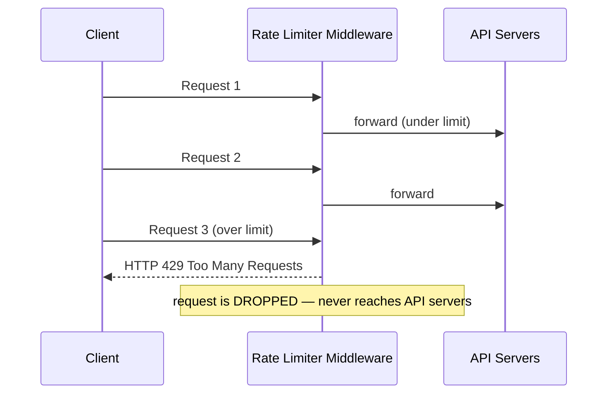

### Where should it live? — Guidelines, not rules

- Evaluate your **current tech stack** — your language/framework must be efficient enough to implement it server-side.
- Identify the **algorithm** that fits your business needs. Implementing it server-side gives **full control**. Third-party gateways may **limit your algorithm choices**.
- If you already have a **microservice architecture with an API gateway** that does auth/IP allowlisting — **add the rate limiter there**.
- Building your own takes **time**. If you don't have enough engineering resources, a **commercial API gateway is the better choice**.

---

## 3. Algorithms for rate limiting

This is the heart of the chapter. **Five algorithms.** Know all five, know the trade-off of each.

---

### 3.1 Token Bucket ⭐ (the workhorse)

**Widely used.** Amazon and Stripe use it.

**How it works:**
- A **container** holds a pre-defined number of tokens (its **capacity**).
- Tokens are **refilled at a preset rate**, periodically. Once the bucket is full, extra tokens **overflow** and are discarded.
- Each request **consumes one token**.
- If enough tokens exist → consume one, **let the request through**.
- If not → the request is **dropped**.

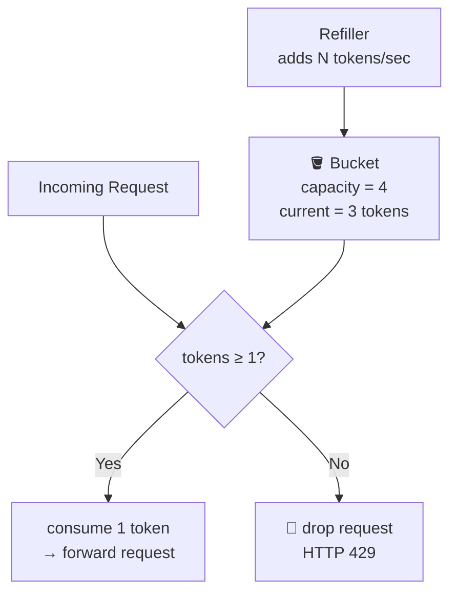

**Two parameters:**
| Parameter | Meaning |
|---|---|
| **Bucket size** | Max tokens allowed in the bucket |
| **Refill rate** | Tokens added per second |

**How many buckets do we need?** Varies. Common patterns:
- **Different buckets per API endpoint.** e.g. a user may post 1/sec, add 5 friends/sec, but like 100 posts/sec → **3 buckets per user**.
- **Rate limit by IP** → a bucket per IP address.
- **Global limit** → one shared bucket for the whole system (e.g. 10,000 req/sec system-wide).

**Pros**
- ✅ Easy to implement
- ✅ Memory efficient
- ✅ **Allows a burst of traffic for short periods** — a request can go through as long as tokens remain. This is often *desirable*: it absorbs legitimate spikes.

**Cons**
- ❌ **Two parameters** (bucket size, refill rate) that may be **challenging to tune** properly.

---

### 3.2 Leaking Bucket

Similar to token bucket, but requests are processed at a **fixed rate**. Implemented with a **FIFO queue**.

**How it works:**
- When a request arrives, check **if the queue is full**.
- If **not full** → **add the request to the queue**.
- If **full** → the request is **dropped**.
- Requests are **pulled from the queue and processed at regular intervals**.

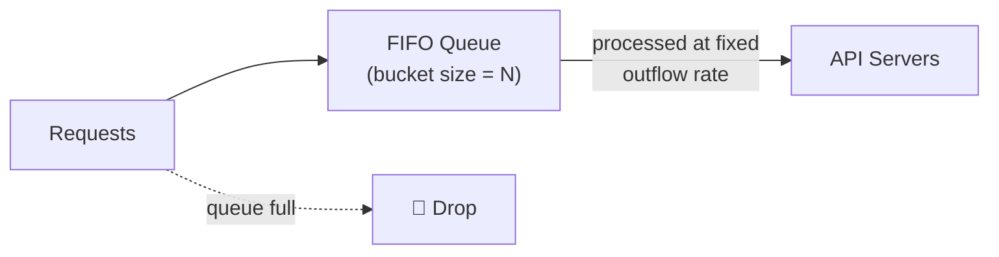

**Two parameters:**
| Parameter | Meaning |
|---|---|
| **Bucket size** | Queue size — number of requests held, waiting to be processed |
| **Outflow rate** | How many requests can be processed per unit time (usually per second) |

Shopify uses leaky bucket for rate limiting.

**Pros**
- ✅ Memory efficient given a limited queue size
- ✅ **Requests are processed at a fixed rate** → suitable for use cases that need a **stable outflow rate**

**Cons**
- ❌ A **burst of traffic fills the queue with old requests**; if they aren't processed in time, **recent requests get rate-limited** — the queue works against you.
- ❌ Two parameters, may not be easy to tune.

> **Token bucket vs leaky bucket in one line:** token bucket **allows bursts**; leaky bucket **smooths** them into a constant rate. Choose based on whether your downstream can tolerate a spike.

---

### 3.3 Fixed Window Counter

**How it works:**
- Divide the timeline into **fixed-size time windows** and assign a **counter** to each.
- Each request **increments the counter** by one.
- Once the counter reaches the **pre-defined threshold**, new requests are **dropped until a new time window starts**.

```mermaid
gantt
    title Fixed Window Counter — limit 3 req/min
    dateFormat  mm
    axisFormat %M
    section Window 1
    3 requests allowed :done, 00, 1m
    section Window 2
    3 requests allowed :done, 01, 1m
```

**The fatal flaw — the boundary burst.**

```
Limit: 5 requests/minute

  |----------- 1:00–2:00 -----------|----------- 2:00–3:00 -----------|
                       ↑↑↑↑↑                ↑↑↑↑↑
                    5 requests            5 requests
                    at 1:59               at 2:01

              →  10 requests in a 2-second span  ←
                 TWICE the allowed rate.
```

A burst of traffic **at the edges of time windows** could cause **more requests than the allowed quota** to go through.

**Pros**
- ✅ Memory efficient
- ✅ Easy to understand
- ✅ **Resetting the available quota at the end of a unit time window** fits certain use cases well (e.g. "1000 API calls per calendar month" billing quotas)

**Cons**
- ❌ **Spike in traffic at the edges of a window** could cause **up to 2× the quota** to pass through.

---

### 3.4 Sliding Window Log

Fixes the fixed-window boundary problem — **exactly**.

**How it works:**
- Keep track of **request timestamps**, usually in a **cache** (e.g. a Redis **sorted set**).
- When a new request comes in, **remove all outdated timestamps** — those older than the start of the current time window.
- **Add** the timestamp of the new request to the log.
- If the **log size is ≤ the allowed count**, the request is **accepted**. Otherwise, it is **rejected**.

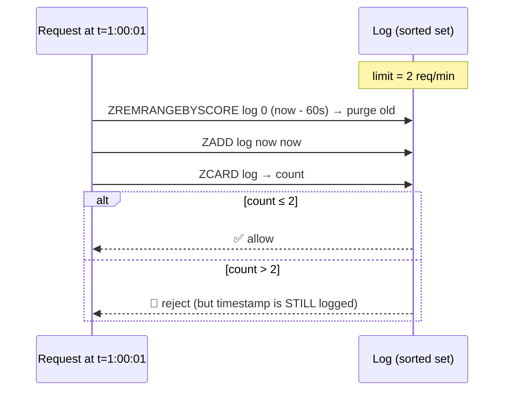

> 🔑 **Subtle and important:** rejected requests' timestamps are **still stored in the log**. This is what makes the algorithm strictly correct — an abusive client that keeps hammering keeps pushing its own window forward and stays blocked.

**Pros**
- ✅ **Rate limiting is very accurate.** In any rolling window, requests will **never exceed the rate limit**.

**Cons**
- ❌ Consumes a **lot of memory** — even rejected requests' timestamps are stored. `O(limit)` memory *per key*.

---

### 3.5 Sliding Window Counter ⭐ (the pragmatic winner)

A **hybrid** of fixed window counter and sliding window log.

**How it works:** estimate the count in the rolling window using a **weighted average** of the current and previous fixed windows.

```
requests in current window
  + requests in previous window × (overlap % of the rolling window with the previous window)
```

**Worked example:**
- Rate limiter allows **7 requests/minute**
- Previous minute: **5** requests. Current minute so far: **3** requests.
- A new request arrives **30% into the current minute** → the rolling window overlaps the previous window by **70%**.

```
count = 3 + (5 × 70%)
      = 3 + 3.5
      = 6.5  →  round down to 6

6 + 1 (this request) = 7  ≤  7  →  ✅ ALLOW
```

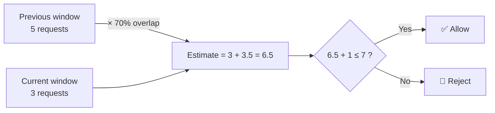

(You may round the floating-point value up or down.)

**Pros**
- ✅ **Smooths out spikes** in traffic because the rate is based on the average rate of the previous window
- ✅ **Memory efficient** — only two counters per key

**Cons**
- ❌ It's an **approximation** — it **only works for a not-so-strict look-back window**. It assumes requests in the previous window were **evenly distributed**.
- However — this problem may **not be as bad as it seems**. Cloudflare's experiments on 400 million requests found only **0.003%** of requests were wrongly allowed or rate-limited.

> **This is the algorithm most production systems should pick.** O(1) memory, no boundary burst, tiny error rate.

---

### Algorithm comparison

| Algorithm | Bursts? | Memory | Accuracy | Complexity | Used by |
|---|---|---|---|---|---|
| **Token bucket** | ✅ Allows | O(1) | Good | Low | Amazon, Stripe |
| **Leaking bucket** | ❌ Smooths | O(queue) | Good | Low | Shopify |
| **Fixed window** | ❌ 2× at boundary | O(1) | **Poor** | Very low | Billing quotas |
| **Sliding window log** | ❌ Never | **O(n)** | **Perfect** | Medium | Strict APIs |
| **Sliding window counter** | ❌ Smooths | O(1) | ~99.997% | Medium | **Cloudflare** |

---

## 4. High-level architecture

**Where do we store counters?** A database is **not** a good idea — **disk access is slow**. **In-memory cache** is chosen: it's fast and supports time-based expiration.

**Redis** is the popular choice. Two commands:
- **`INCR`** — increases the stored counter by 1
- **`EXPIRE`** — sets a timeout for the counter. After the timeout, the counter is automatically deleted.

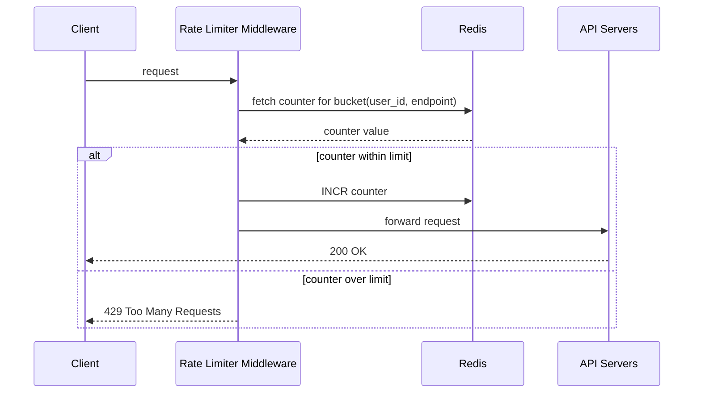

---

## 5. Step 3 — Design deep dive

### 5.1 Rate limiting rules

Rules are generally written in **configuration files and saved on disk**. Lyft open-sourced their rate-limiting component; here's the flavour:

```yaml
domain: messaging
descriptors:
  - key: message_type
    value: marketing
    rate_limit:
      unit: day
      requests_per_unit: 5
```
*Clients are not allowed to send more than 5 marketing messages per day.*

```yaml
domain: auth
descriptors:
  - key: auth_type
    value: login
    rate_limit:
      unit: minute
      requests_per_unit: 5
```
*Clients are not allowed to log in more than 5 times in 1 minute.*

**Workers frequently pull rules from disk and store them in the cache.**

---

### 5.2 Exceeding the rate limit — what does the client see?

Return **HTTP 429 Too Many Requests**.

Depending on the use case, you may **enqueue** rate-limited requests to be processed later (e.g. a system that's overloaded but the orders are valid).

**Rate limiter headers** — how clients discover their limits:

| Header | Meaning |
|---|---|
| `X-Ratelimit-Remaining` | Remaining number of allowed requests within the window |
| `X-Ratelimit-Limit` | How many calls the client can make per time window |
| `X-Ratelimit-Retry-After` | Number of **seconds to wait** until you can make a request again without being throttled |

When a user has sent too many requests, a **429** is returned **along with `X-Ratelimit-Retry-After`**.

> 🔑 **Always return `Retry-After`.** Without it, well-behaved clients will retry immediately and hammer you harder. This single header converts a hostile retry storm into cooperative backoff.

---

### 5.3 Detailed design

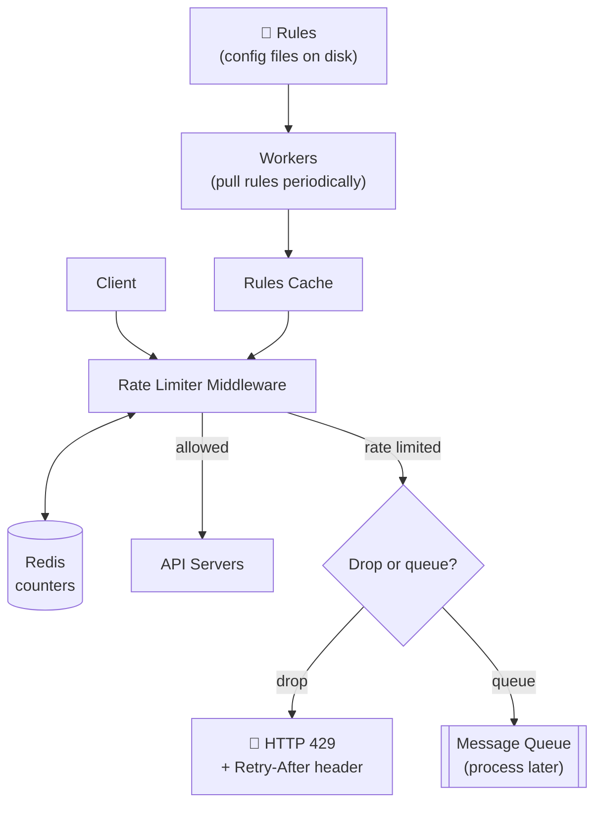

**Flow:**
1. Rules are stored on disk. Workers frequently pull them and store them in the cache.
2. A client request goes to the **rate limiter middleware** first.
3. The middleware **loads rules from the cache**, fetches **counters and the last request timestamp from the Redis cache**.
4. **If not rate limited** → the request is forwarded to the API servers.
5. **If rate limited** → a **429** error is returned to the client. The request is either **dropped** or **forwarded to a queue**.

---

### 5.4 Rate limiter in a distributed environment ⚠️

Scaling to support multiple servers and concurrent threads introduces **two hard problems**.

#### Problem 1 — Race condition

The classic read-modify-write hazard.

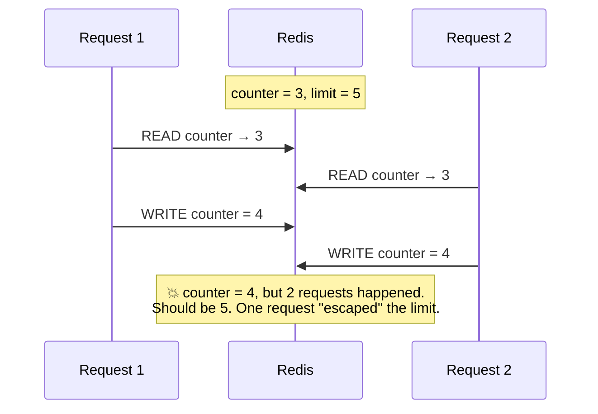

Two requests concurrently read the counter value (3) before either writes it back. Each increments and writes 4. **Both assume they have the correct value.** Under high concurrency, this leaks a *lot* of requests past the limit.

**Solutions:**
- **Locks** — the obvious solution, but they **significantly slow down the system**. ❌ *(This is a trap answer.)*
- **Lua script** — ✅ Redis executes a Lua script **atomically**. Read + check + increment in one indivisible step.
- **Sorted sets** — ✅ a Redis data structure that supports the sliding-window-log algorithm atomically.

**Canonical Lua approach:**
```lua
-- KEYS[1] = bucket key, ARGV[1] = limit, ARGV[2] = window seconds
local current = redis.call('INCR', KEYS[1])
if current == 1 then
  redis.call('EXPIRE', KEYS[1], ARGV[2])
end
if current > tonumber(ARGV[1]) then
  return 0   -- reject
end
return 1     -- allow
```
Single round trip. Atomic. No lock. This is the answer they want.

#### Problem 2 — Synchronization

Multiple rate limiter servers are needed. But **HTTP is stateless** — a client may send requests to **different rate limiters**.

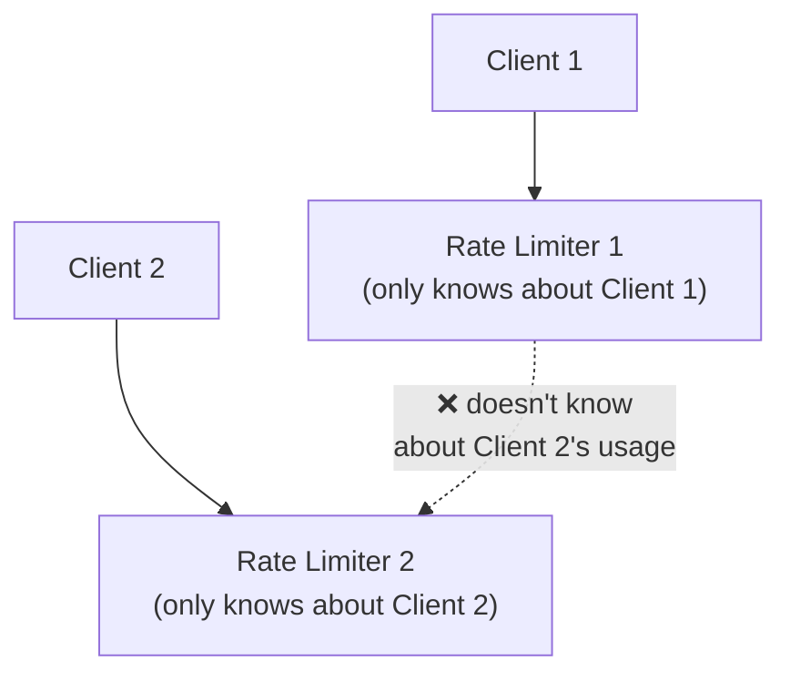

If Rate Limiter 1 doesn't know about Client 2, the limiter **cannot work correctly**.

**Solutions:**
- **Sticky sessions** — pin a client to the same rate limiter. ❌ **Not advisable** — it is **neither scalable nor flexible**.
- **Centralized data store like Redis.** ✅ This is the answer. All rate limiter servers read and write to the **same Redis**, so there's a single source of truth.

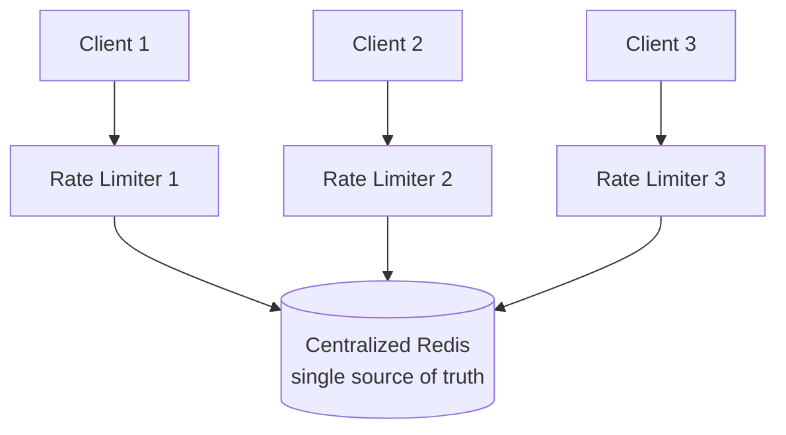

---

### 5.5 Performance optimization

**Two areas.**

**1. Multi-data center setup.**
Latency is high for users far from the data center. Most cloud providers build **edge server locations around the world**. Traffic is **automatically routed to the closest edge server** to reduce latency. (Cloudflare has 194 geographically distributed edge servers.)

**2. Synchronize data with an eventual consistency model.**
Don't use strong consistency across regions — the cross-region round trip (~150 ms) destroys the latency budget. Use **eventual consistency**. Accept a small amount of over-admission at region boundaries.

---

### 5.6 Monitoring

After deployment, gather analytics to check that:
1. **The rate limiting algorithm is effective.**
2. **The rate limiting rules are effective.**

**If rules are too strict, many valid requests are dropped.** In that case, **loosen them a little**.

**If the limiter becomes ineffective during a sudden traffic increase** (e.g. a flash sale), **replace the algorithm** to support burst traffic — the **token bucket** is a good fit here.

---

## 6. Step 4 — Wrap up

### Algorithms recap
- Token bucket, leaking bucket, fixed window, sliding window log, sliding window counter
- System architecture, distributed environment, performance, monitoring

### Additional talking points

**Hard vs soft rate limiting**
- **Hard:** the number of requests **cannot exceed** the threshold. Ever.
- **Soft:** requests **can exceed the threshold for a short period**. (Burst tolerance built in.)

**Rate limiting at different levels.**
This chapter discussed the **application layer (Layer 7)**. But rate limiting can be applied at **other layers** — e.g. **iptables** allows rate limiting by **IP address (Layer 3)**.

**Avoid being rate limited — design your client well:**
- Use **client cache** to avoid making frequent API calls
- Understand the limit and **do not send too many requests in a short time frame**
- Include **code to catch exceptions or errors** so your client can gracefully recover from them
- Add sufficient **back-off time** to retry logic

---

## 7. Senior-level notes

- **Fail open, not closed.** If Redis is unreachable, the rate limiter should **allow** the request, not block it. Rate limiting is a *protection*, not a *correctness* mechanism. Blocking all traffic because your limiter is down is a self-inflicted outage. (Exception: if you're limiting an expensive third-party paid API, failing closed may be correct — say so explicitly, and know why you're deviating.)
- **Latency budget.** The limiter is on the hot path of every request. Budget it **< 5 ms p99**. That means: one Redis round trip max, connection pooling, and colocating Redis with the limiter.
- **Local + global two-tier limiting.** For extreme scale, do an in-process approximate check first (rejects the obvious abusers with zero network calls), and only consult Redis for requests that pass. This cuts Redis load by an order of magnitude.
- **Rate limit key design matters.** By IP → breaks behind corporate NAT and CGNAT (one office = one IP = everyone throttled). By user ID → doesn't protect unauthenticated endpoints like `/login` or `/signup`, which are exactly the ones under attack. In practice you need **layered keys**: IP for anonymous, user_id for authenticated, API-key for partners.
- **Throttle by cost, not by count.** A `GET /health` and a `POST /generate-report` are not equal. Advanced limiters assign a **token cost per endpoint** (this is exactly what the token bucket enables — consume 1 token for cheap calls, 50 for expensive ones).
- **Redis becomes the bottleneck and the SPOF.** Shard by rate-limit key. Use Redis Cluster. Have a fallback path.

---

## 8. Interview Questions

**Warm-up**
1. What HTTP status code does a rate limiter return, and what header must accompany it? Why does that header matter so much?
2. Why can't you implement rate limiting on the client side?
3. Name the five rate limiting algorithms.

**Core**
4. Explain the boundary-burst problem in the fixed window counter with a concrete example. How much can a client exceed the limit by?
5. Why does the sliding window log store timestamps of *rejected* requests too?
6. Compare the token bucket and the leaking bucket. Which would you pick for an API in front of a fragile legacy database, and why?
7. Walk me through the sliding window counter formula with numbers.
8. Two concurrent requests read the counter as 3 and both write 4. What is this bug, and why is a distributed lock the *wrong* fix?

**Deep / senior**
9. Redis, your counter store, goes down. What should the rate limiter do — allow all traffic or block all traffic? Defend your answer, then argue the opposite side.
10. Your rate limiter adds 40 ms of p99 latency. Diagnose and fix.
11. You rate limit by IP. A large enterprise customer behind a single NAT gateway complains that their whole office is throttled. How do you fix this without weakening protection against attackers?
12. You have limiters in 5 regions and a global limit of 1,000 req/min per user. Strongly consistent counting across regions costs 150 ms. What do you do?
13. Design rate limiting where different endpoints have different costs (a search costs 1 unit, a report costs 100). Which algorithm makes this natural?
14. Your rate limiter is working perfectly and an attacker is still taking you down. What layer are they attacking, and what do you add?

**Discussion**
15. When is rate limiting the *wrong* tool, and what should you use instead? (Hint: load shedding, admission control, backpressure, quotas.)
